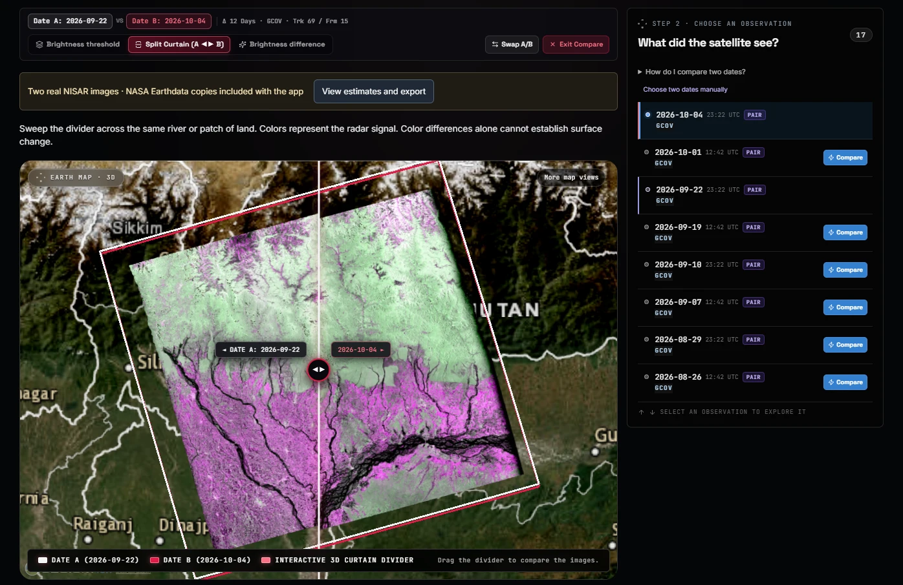
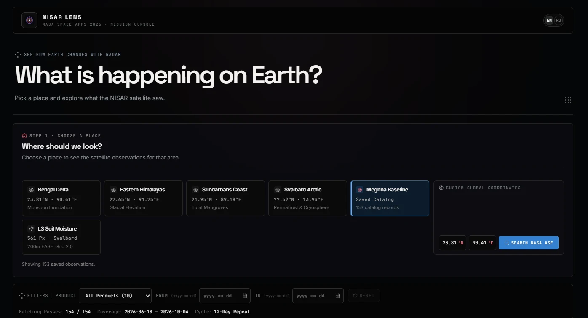
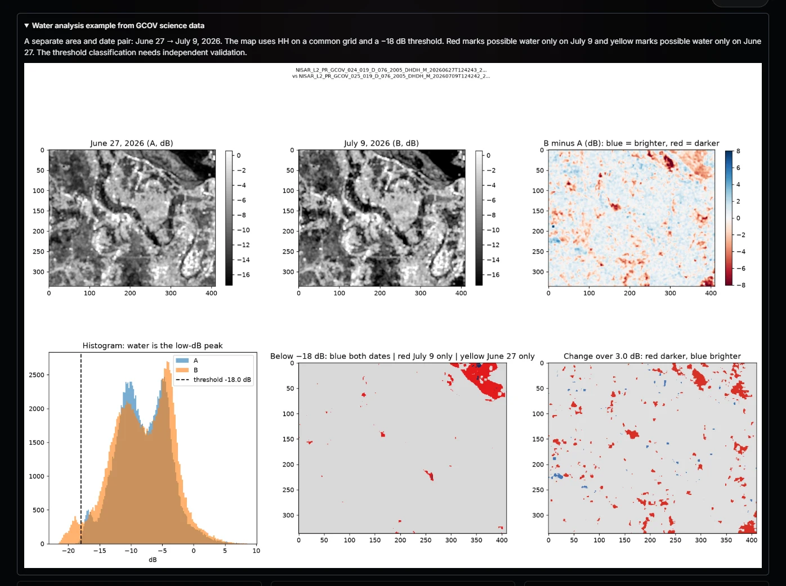

# NISAR Lens

Finding comparable radar observations and interpreting changes across dates can be difficult without geospatial tools. NISAR Lens makes NASA–ISRO NISAR observations explorable in a browser, with catalog search, repeat-pass comparison on a 3D globe, and a worked example of possible changes in surface water.

**Team Beles · NASA Space Apps Challenge 2026 · [Dancing with the SARs](https://www.spaceappschallenge.org/2026/challenges/dancing-with-the-sars/)**

[Live demo](https://nisar-lens.vercel.app/) · [Demo video (MP4)](NISAR-Lens.mp4) · [Presentation (PDF)](NISAR-Lens.pdf) · [Quick start](#quick-start) · [Walkthrough](#walkthrough) · [Data and methods](#data-and-methods) · [Architecture](#architecture) · [License](#license)



## Quick start

Use Node.js 22 or later, npm, and a browser with WebGL and hardware acceleration enabled.

```bash
git clone https://github.com/thebeles/nisar-lens.git
cd nisar-lens
npm ci
npm run dev
```

Open [http://localhost:5173](http://localhost:5173), or the address printed by Vite. The bundled catalog, comparison pair, water case, and soil moisture example work without an Earthdata token. Live search and detailed basemap imagery depend on external services.

### Optional configuration

Create a local `.env` using [`.env.example`](.env.example) as a reference. Restart the dev server after changing the file. Git ignores the local `.env` and tracks the example template.

| Variable | Purpose |
| --- | --- |
| `EARTHDATA_TOKEN` | Server-side bearer token for protected Earthdata assets used by online observations. |
| `VITE_CESIUM_ION_TOKEN` | Enables Cesium ion terrain and imagery where available. |

Run `npm run build` to generate `dist/` and `npm run preview` to inspect the production frontend. Use `npm run dev` locally for the ASF and Earthdata API routes.

## Walkthrough

1. **Find a radar observation.** Select **Meghna Baseline**, set **Product** to **GCOV**, and click **Open selected image**. The catalog shows where each acquisition was taken. **Metadata** and **SAR Browse** show product details and the available previews. **Search NASA ASF** loads observations for a latitude and longitude.
2. **Compare repeat passes.** Click **Compare two NISAR images** to open two observations from track 69, frame 15, acquired 12 days apart. Drag the split curtain across the same patch of land or river. Use **Swap A/B** to reverse the dates. The timeline also supports automatic pairing and manual selection of compatible observations.
3. **Inspect and export the comparison.** Switch to **Brightness difference** or **Brightness threshold** to inspect the overlap. Open **View estimates and export** to adjust the relative threshold, see the shares of pixels in each class, and download a JSON report or a PNG mask.
4. **Open the scientific water case.** In the comparison details, expand **Water analysis example from GCOV science data**. The chart shows a separate pair of acquisitions and the possible water changes calculated from their HH radar channel.
5. **Explore a second region.** Exit comparison and select **L3 Soil Moisture** to see a 561-cell example over Svalbard on a 200 m grid. This example shows soil moisture for a single acquisition. Saved observations and pairs stay in the current browser.



## Data and methods

### Browser comparison

The demo uses two real NASA Earthdata LATLON browse PNGs from the provisional NISAR L2 GCOV collection. The app bundles reduced-size copies and records the original URLs and granule IDs in the catalog and JSON export. It aligns the previews approximately using their catalog footprint bounds, then compares luminance across the shared extent. The resulting classes describe relative preview brightness. Image rendering, terrain, and vegetation can affect that brightness, so these classes cannot establish physical backscatter change or water extent.

### Scientific water case

The worked example uses two GCOV HDF5 acquisitions from **June 27 and July 9, 2026**, over a separate area in Bangladesh (track 19, frame 76). The Python script aligns the L-band HH power arrays to a common projected grid, smooths the power over a 5 × 5 pixel window, converts it to decibels, and applies a fixed **−18 dB** threshold. Red indicates possible water on July 9 only. Yellow indicates possible water on June 27 only. The threshold classification needs independent validation before it can support claims about flooding or water extent.



The [full-resolution chart](nisar_area3/outputs/water_change.png) is bundled with the app. To reproduce it from the original HDF5 files, use an environment with Python, the packages below, and a NASA Earthdata Login token. The download script prompts for the token and places the input files in `nisar_area3/nisar_data/`. The processing script writes the chart and NumPy arrays to `nisar_area3/outputs/`. Git ignores the downloaded HDF5 files and generated NumPy arrays. Rerunning the analysis overwrites the tracked chart locally.

```bash
python -m pip install asf_search h5py numpy scipy pyproj matplotlib
python nisar_area3/s7_download_gcov.py
python nisar_area3/s8_water_change.py
```

### Data and resources

| Source | How NISAR Lens uses it |
| --- | --- |
| [NASA Earthdata Search](https://search.earthdata.nasa.gov/search?q=NISAR_L2_GCOV_PROVISIONAL_V1) · [ASF GCOV product guide](https://nisar-docs.asf.alaska.edu/gcov/) | `NISAR_L2_GCOV_PROVISIONAL_V1` browse images and scientific HDF5 data for the two comparison examples. |
| [ASF Search API](https://api.daac.asf.alaska.edu/services/search/param?platform=NISAR&maxResults=2&output=json) · [ASF Vertex](https://search.asf.alaska.edu/) | Catalog metadata, acquisition footprints, and discovery of new observations. |
| [NISAR L3 SME2 product DOI](https://doi.org/10.5067/NIL3SME2-P1) | Provisional soil moisture observations for the Svalbard example. |
| [Esri World Imagery](https://services.arcgisonline.com/ArcGIS/rest/services/World_Imagery/MapServer) · [Esri World Boundaries and Places](https://services.arcgisonline.com/ArcGIS/rest/services/Reference/World_Boundaries_and_Places/MapServer) | Basemap imagery and place labels used by the globe. |

<details>
<summary>NISAR granules used in the demo</summary>

| Example | Acquisition date | Granule ID |
| --- | --- | --- |
| Browser comparison | 2026-09-22 | `NISAR_L2_PR_GCOV_031_069_A_015_4005_DHDH_A_20260922T232205_20260922T232240_P05023_N_F_J_001` |
| Browser comparison | 2026-10-04 | `NISAR_L2_PR_GCOV_032_069_A_015_4005_DHDH_A_20261004T232205_20261004T232240_P05023_N_F_J_001` |
| Scientific water case | 2026-06-27 | `NISAR_L2_PR_GCOV_024_019_D_076_2005_DHDH_M_20260627T124243_20260627T124317_P05023_N_F_J_001` |
| Scientific water case | 2026-07-09 | `NISAR_L2_PR_GCOV_025_019_D_076_2005_DHDH_M_20260709T124242_20260709T124317_P05023_N_F_J_001` |
| Svalbard soil moisture | 2026-09-27 | `NISAR_L3_PR_SME2_031_141_A_045_0005_NASV_A_20260927T233048_20260927T233132_P05023_N_F_J_001` |

</details>

The [bundled ASF catalog](public/data/nisar-catalog.json) contains the original browse URLs. The [water case script](nisar_area3/s8_water_change.py) records the HDF5 filenames and study bounds. The [SME2 data module](src/features/explorer/sme2Data.js) contains the points rendered by the app.

### Documentation attribution

OpenAI Codex assisted with editing and verifying this README. The screenshots were captured from the running application in Chrome.

## Architecture

React and Vite power the interface. Cesium renders the globe, acquisition footprints, and comparison overlays. Browser canvas code computes the preview comparisons. Server routes provide ASF catalog search and proxy protected Earthdata assets. The application runs without an external database.

| Path | Responsibility |
| --- | --- |
| [`src/features/explorer/`](src/features/explorer/) | Catalog filters, timeline, globe, imagery viewer, comparison, and exports. |
| [`api/`](api/) | Server handlers for ASF search and Earthdata assets. |
| [`public/data/`](public/data/) | Bundled ASF metadata and NASA Earthdata preview copies. |
| [`nisar_area3/`](nisar_area3/) | GCOV pair discovery, download and processing scripts, plus the water analysis chart used by the app. |
| [`nisar_sme2.json`](nisar_sme2.json) | Source export for the bundled Svalbard soil moisture example. |
| [`DEMO_GUIDE.md`](DEMO_GUIDE.md) | Extended Russian-language walkthrough for local testing and presentations. |

## License

The original NISAR Lens code, documentation, and other original project materials are licensed under the [Apache License 2.0](LICENSE). NISAR data and imagery, basemap tiles, and third-party dependencies are subject to their respective providers’ terms. See [Data and resources](#data-and-resources) for the data and imagery providers.
